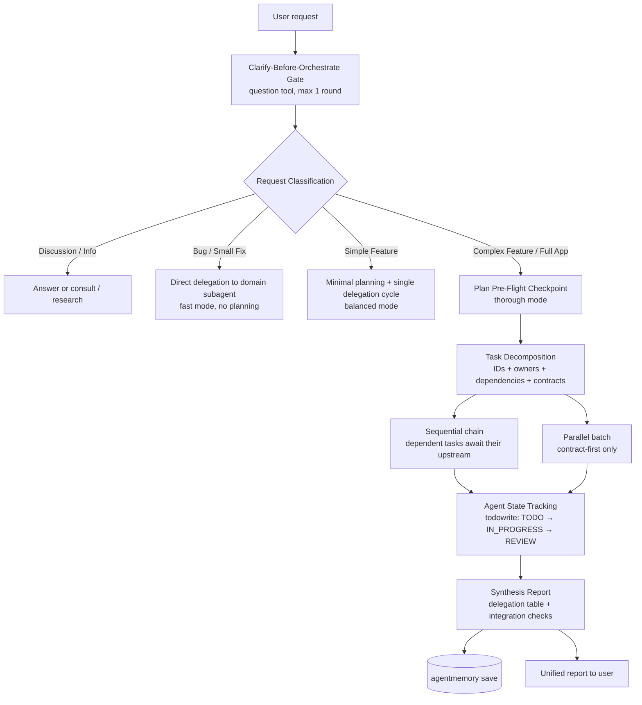

# Agent Architecture

> How the kit defines, organizes, and orchestrates its 47 agents — one leader, one quality primary, and 45 domain subagents.

**Related docs**: [AGENT_DIRECTORY.md](AGENT_DIRECTORY.md) (full agent reference) · [DELEGATION_WORKFLOW.md](DELEGATION_WORKFLOW.md) (operational workflow) · [CONFIGURATION.md](CONFIGURATION.md) (config reference) · [INTEGRATION_ANALYSIS.md](INTEGRATION_ANALYSIS.md) (how v1.4.0 came together)

---

## 1. How agents are defined

This kit has no compiled agent runtime. An agent is **two files plus one JSON entry**:

| Layer                    | File                                        | What it contains                                                                                                                                                        |
| ------------------------ | ------------------------------------------- | ----------------------------------------------------------------------------------------------------------------------------------------------------------------------- |
| Registration             | `opencode.json` → `agent.<name>`            | `description`, `mode` (`primary` \| `subagent`), `prompt` reference, `color`, and a `permission` block                                                                  |
| Prompt                   | `.opencode/prompts/agents/<name>.md`        | Plain Markdown: role identity, global rules, what the agent does / does not do, skills to load on demand, and its output contract                                       |
| (optional) Configuration | `opencode.json` → `agent.<name>.permission` | Per-agent tool permissions: `edit`/`webfetch`/`skill` allow flags, a `bash` allow-list, MCP-tool wildcards (e.g. `nuxt_*`, `sonarqube_*`), and `task` delegation rights |

The prompt is wired by reference — `agent.leader.prompt` is `"{file:.opencode/prompts/agents/it-leader.md}"` — so editing the Markdown changes the agent's behavior with no code build step. Because prompts are plain Markdown, adding a new agent is a JSON entry + one Markdown file, nothing else.

**Inventory (v1.4.0):**

| Count | What                                                                                                                                                   |
| ----- | ------------------------------------------------------------------------------------------------------------------------------------------------------ |
| 47    | Registered agents in `opencode.json`: 2 primaries (`leader`, `sonarqube`) + 45 subagents                                                               |
| 48    | Prompt files in `.opencode/prompts/agents/` — the extra `nuxt-frontend-developer-mentor.md` is a legacy reference file, **not** registered as an agent |
| 12    | MCP servers (see [INTEGRATION_ANALYSIS.md](INTEGRATION_ANALYSIS.md) §4.6 for the two additions)                                                        |

### Roles: primary vs subagent

| Mode       | Agents                | Behavior                                                                                                                                                                                    |
| ---------- | --------------------- | ------------------------------------------------------------------------------------------------------------------------------------------------------------------------------------------- |
| `primary`  | `leader`, `sonarqube` | Interactive agents the user can talk to directly. `leader` is the default orchestrator; `sonarqube` is a standalone quality-gate entry point.                                               |
| `subagent` | All 45 others         | Invoked only by the leader (or `sonarqube` when routing fixes) via the `task` tool. Each returns a structured **DELEGATION RESULT** (see [DELEGATION_WORKFLOW.md](DELEGATION_WORKFLOW.md)). |

Subagents are intentionally prevented from orchestrating each other: their prompts state "You NEVER orchestrate other agents" and they report findings back to the IT Leader instead of delegating onward. The single exception boundary is `@agent-engineer` — it _builds_ agent software, it does not run the development team.

## 2. The leader-as-orchestrator model

The architecture keeps **one central orchestrator** (`@leader`, prompt file `it-leader.md`) and pushes everything else to specialists:

- **The leader does not code.** Its delegation mandate is absolute: any application-code change — even one character — must be delegated. The leader reads code only to gather context for delegation.
- **The leader owns**: requirements analysis, architecture planning, task decomposition, delegation contracts, integration verification, progress tracking, and project configuration (`.opencode/` configs).
- **Specialists own**: implementation (per stack), design, review, testing, security, infrastructure, and documentation.

Delegation happens through OpenCode's **`task` tool**: the leader sends a structured contract (scope, out-of-scope, input interface, expected output, verification criteria) and receives a structured result (files changed, verification status, deviations). This is the contract-first model detailed in [DELEGATION_WORKFLOW.md](DELEGATION_WORKFLOW.md).

Two supporting mechanisms keep the loop disciplined:

1. **`todowrite` progress tracking** — every task has a stable ID, a state, and an owner; only ONE task may be `IN_PROGRESS` per agent at a time.
2. **agentmemory** — cross-session memory (MCP server) captures conventions, decisions, and lessons; the leader injects relevant memory into delegation contracts rather than letting subagents write memory directly.

## 3. Department structure

The 47 agents are organized into departments (adapted from [INTEGRATION_ANALYSIS.md](INTEGRATION_ANALYSIS.md) §6; `seo` is listed explicitly here, and `designer`/`ui-ux-designer` are one agent — `ui-ux-designer.md` is the designer's prompt filename):

```
leader (primary orchestrator — IT Leader)
├── Management & Orchestration ......... leader, sonarqube, harness-optimizer, loop-operator
├── Planning & Research ................ planner (NEW), product-manager (NEW),
│                                        code-archaeologist (NEW), docs-lookup
├── Architecture & Design .............. architect (NEW), api-architect (NEW), designer
├── Frontend Development ............... frontend-nuxt, frontend-react, angular
├── Backend Development ................ node-developer, ci3, laravel, java-developer,
│                                        go-developer, python, rust, swift, dotnet, cpp,
│                                        ruby-developer (NEW)
├── Database & Data .................... database, data-engineer (NEW)
├── Mobile ............................. android, flutter
├── Game Development (new dept) ........ game-developer (NEW)
├── Testing & QA ....................... test-engineer (NEW)
├── Security & Review .................. security-auditor (NEW), reviewer, debugger (NEW),
│                                        performance-optimizer (NEW),
│                                        python-reviewer, rust-reviewer, cpp-reviewer,
│                                        java-reviewer, php-reviewer, kotlin-reviewer,
│                                        go-reviewer
├── DevOps & Infrastructure ............ devops, cloud-architect (NEW)
├── Documentation ...................... doc-writer (NEW), agent-engineer
└── Discovery & Growth ................. seo
```

Full per-agent details live in [AGENT_DIRECTORY.md](AGENT_DIRECTORY.md).

## 4. Orchestration flow

The leader's workflow is a fixed pipeline (merged from the donor kit's boundary-enforcement concepts; see [INTEGRATION_ANALYSIS.md](INTEGRATION_ANALYSIS.md) §6):



Step by step:

| #   | Stage                               | What happens                                                                                                                                                                                                                                                                                                                                                                                                                                                                       |
| --- | ----------------------------------- | ---------------------------------------------------------------------------------------------------------------------------------------------------------------------------------------------------------------------------------------------------------------------------------------------------------------------------------------------------------------------------------------------------------------------------------------------------------------------------------- |
| 1   | **Request classification**          | Every request is typed (Discussion / Info / Bug Fix / Small Fix / Simple Feature / Complex Feature / Full Application); the type selects the operating mode (`fast` / `balanced` / `thorough`).                                                                                                                                                                                                                                                                                    |
| 2   | **Clarify-Before-Orchestrate Gate** | If the goal, stack, scope, or acceptance criteria are ambiguous, the leader asks structured questions via the `question` tool — max ONE round of 2–4 questions — then commits to the best interpretation and states the assumption explicitly.                                                                                                                                                                                                                                     |
| 3   | **Plan Pre-Flight Checkpoint**      | For Complex Feature / Full App plans (especially from `@planner`), a 9-item checklist runs before any delegation: every task has ID/owner/input/output/dependencies/priority, owners match the file-type ownership matrix, shared contracts are defined first, dependencies form a DAG, verification criteria exist, the security gate is identified, UI tasks follow the 3-phase UI pipeline, and scope is user-confirmed. Result is recorded as `Pre-flight: PASS (n/n checks)`. |
| 4   | **Task decomposition**              | Tasks get hierarchical IDs (`FE-001`, `BE-002`), an owner agent, dependencies, priority, and verification criteria; plans may be authored by `@planner` into `docs/plans/<task-slug>.md`.                                                                                                                                                                                                                                                                                          |
| 5   | **Contract-first delegation**       | Sequential when tasks share interfaces or data; parallel only when contracts (API schemas, types, DB schema) are defined **before** either side starts. No mass fan-out.                                                                                                                                                                                                                                                                                                           |
| 6   | **Agent state tracking**            | Every task moves through `BACKLOG → TODO → IN_PROGRESS → REVIEW → DONE` (with `BLOCKED` / `CANCELLED`), tracked in `todowrite` and reported as visual progress tables.                                                                                                                                                                                                                                                                                                             |
| 7   | **Synthesis report**                | After all delegations for a feature/phase, ONE unified report — never raw subagent output — with a delegation table, integration checks (API alignment, type compatibility, error handling, auth boundaries, ownership), deviations, and follow-ups.                                                                                                                                                                                                                               |

The lifecycle table and full transition rules are in [DELEGATION_WORKFLOW.md](DELEGATION_WORKFLOW.md).

## 5. File-type ownership and boundary enforcement

To prevent two agents editing the same file in conflicting ways, the leader prompt defines a **File-Type Ownership Matrix**: every file type has exactly one **owner** (the agent permitted to edit it) and optional **advisory** agents (may review, not edit). Examples:

| File type (examples)                               | Owner                      | Advisory                              |
| -------------------------------------------------- | -------------------------- | ------------------------------------- |
| `components/`, `pages/`, `composables/` (Vue/Nuxt) | `@frontend-nuxt`           | `@designer`, `@reviewer`              |
| `src/**/*.spec.ts` / `*.test.ts` / `e2e/`          | `@test-engineer`           | Feature agent (fixes impl, not tests) |
| API routes, `*.dto.ts`, `*.controller.ts` (Node)   | `@node-developer`          | `@api-architect`                      |
| `prisma/schema.prisma`, migrations, SQL            | `@database`                | `@architect`, feature agent           |
| OpenAPI/GraphQL schemas (shared contracts)         | `@api-architect`           | All consuming agents                  |
| Auth flows, secrets handling, security headers     | `@security-auditor` (gate) | Feature agent (implementation)        |
| `docs/`, `README.md`, `CHANGELOG.md` (prose)       | `@doc-writer`              | Feature agent (facts only)            |

The complete matrix is in [DELEGATION_WORKFLOW.md](DELEGATION_WORKFLOW.md). Enforcement rules:

1. **One owner per file** per delegation cycle; conflicting edits are a contract violation — flagged in the result's "Deviations" section and escalated (accept / revert / re-delegate).
2. **Shared contracts first**: when two agents must touch the same interface, the contract is defined before either starts.
3. **Boundary check at synthesis**: before reporting done, the leader verifies each changed file was edited by its matrix owner (this is a checkbox in the synthesis report).

## 6. How the 14 new agents fit in

The Skeletorflet integration added 14 agents ([INTEGRATION_ANALYSIS.md](INTEGRATION_ANALYSIS.md) §4.1) without changing the leader's central role:

| New agent               | Source (donor)                                                | Department              |
| ----------------------- | ------------------------------------------------------------- | ----------------------- |
| `planner`               | project-planner                                               | Planning & Research     |
| `architect`             | Derived (architecture skill + orchestrator advisory concepts) | Architecture & Design   |
| `product-manager`       | product-manager                                               | Planning & Research     |
| `api-architect`         | graphql-developer + api-patterns                              | Architecture & Design   |
| `data-engineer`         | data-engineer                                                 | Database & Data         |
| `debugger`              | debugger                                                      | Security & Review       |
| `test-engineer`         | test-engineer                                                 | Testing & QA            |
| `security-auditor`      | security-auditor                                              | Security & Review       |
| `performance-optimizer` | performance-optimizer                                         | Security & Review       |
| `code-archaeologist`    | code-archaeologist                                            | Planning & Research     |
| `doc-writer`            | documentation-writer                                          | Documentation           |
| `cloud-architect`       | cloud-architect                                               | DevOps & Infrastructure |
| `ruby-developer`        | ruby-developer                                                | Backend Development     |
| `game-developer`        | game-developer                                                | Game Development (new)  |

Key design points of the integration:

- **All 14 were rewritten in house style** before registration: subagent mode, delegation-contract output format, verification status (`verified` / `partially_verified` / `not_verified`), scoped permissions, and no orchestrator duplication — the donor's boundary-enforcement concepts moved into the _leader prompt_, not into the new agents.
- **They slot into existing routing rules** rather than creating new orchestration paths. The leader prompt gained routing entries for each (e.g. "recurring bug, failed fix, or unknown cause → `@debugger`", "new API surface → `@api-architect` BEFORE the backend agent starts"). The delegation count grows; the orchestration model does not.
- **The leader remains the single orchestrator.** Every new agent is a subagent; none may delegate onward, and advisory agents (`@architect`, `@api-architect`) explicitly never implement.
- **Complement, not overlap**: `@cloud-architect` handles AWS/Azure/GCP design while `@devops` keeps CI/CD execution; `@security-auditor` is the deep-audit gate while `@security-reviewer` (built-in) stays for routine scans; `@debugger` finds root causes while domain owners apply language-specific fixes (the debugger prompt documents this co-ownership note explicitly).

## Related docs

- [AGENT_DIRECTORY.md](AGENT_DIRECTORY.md) — complete reference of all 47 registered agents + built-ins
- [DELEGATION_WORKFLOW.md](DELEGATION_WORKFLOW.md) — the end-to-end contract-driven workflow
- [INTEGRATION_ANALYSIS.md](INTEGRATION_ANALYSIS.md) — how v1.4.0 components were selected and merged
